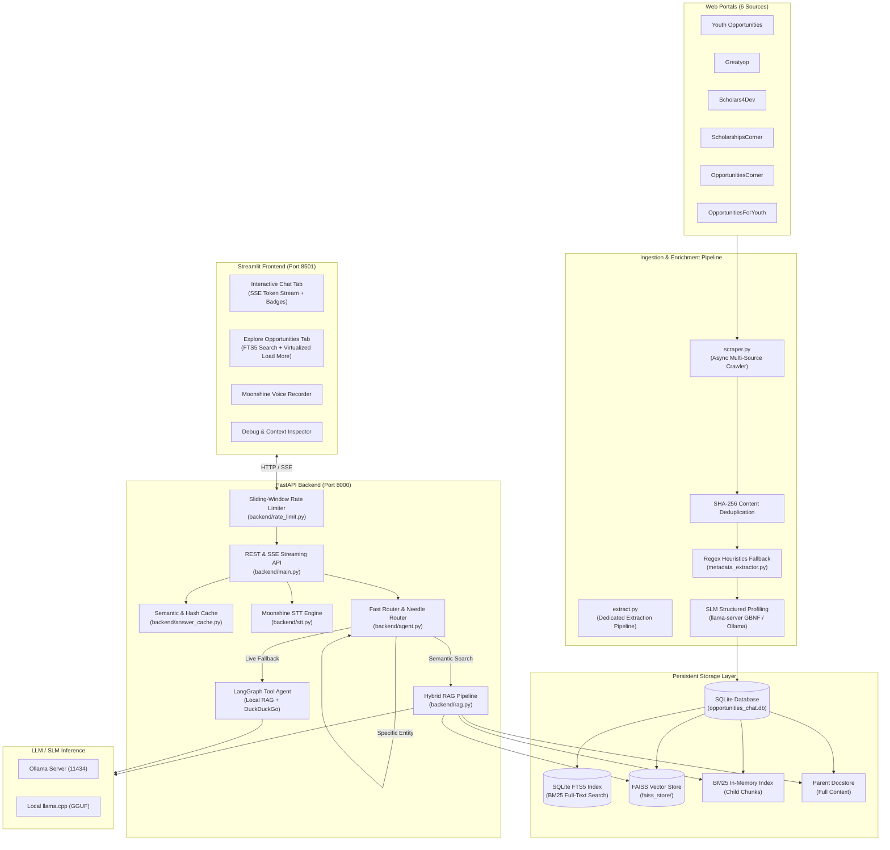
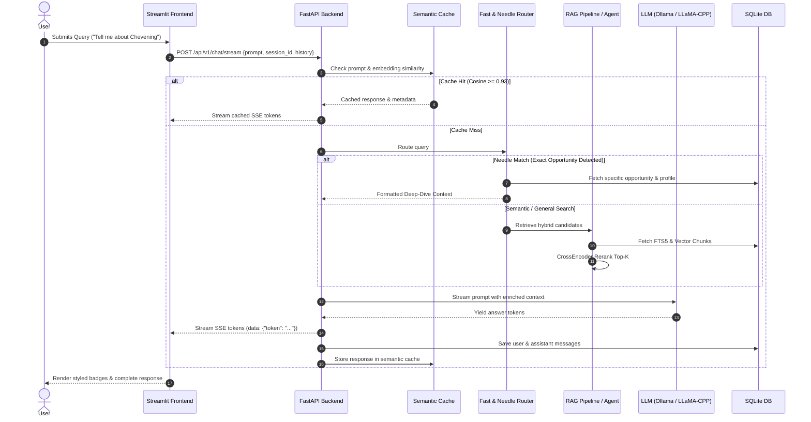
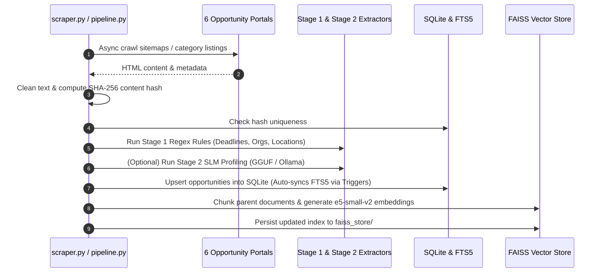

# 01 — System Architecture & Overview

## 1. Purpose & Vision

**Opportunities-Details** is a high-performance, production-ready Retrieval-Augmented Generation (RAG) platform, crawler, and search engine for global scholarships, fellowships, grants, and internships.

The system addresses the information fragmentation across global scholarship databases:
1. **Automated Scraping & Ingestion**: Crawls and parses structured content from 6 major scholarship portals with content hashing and deduplication.
2. **Metadata Enrichment**: Employs deterministic regex rules (Stage 1) and local Small Language Models (SLM via GGUF/Ollama, Stage 2) to extract normalized deadlines, organizations, target locations, program levels, and funding types.
3. **Hybrid Search & Retrieval**: Combines SQLite FTS5 (BM25 full-text search) for exact metadata and title matching with FAISS (`e5-small-v2`) vector search and `ms-marco-MiniLM-L12-v2` cross-encoder reranking.
4. **Intelligent Query Routing**: Distinguishes between conversational chit-chat, specific opportunity deep-dives (via `NeedleRouter`), broad semantic searches, and live web inquiries.
5. **Multi-Modal Client Interfaces**: A FastAPI backend providing REST and Server-Sent Events (SSE) streaming APIs, paired with a feature-rich Streamlit frontend featuring voice input (Moonshine STT), thought-chain visualization, and virtualized opportunity browsing.

---

## 2. System Architecture

---

## 3. Core Component Overview

| Component | Primary Files | Key Responsibilities |
|---|---|---|
| **API Server** | `backend/main.py` | FastAPI application exposing endpoints for chat streaming, opportunities CRUD, session management, audio transcription, and scraper triggers. |
| **Configuration** | `config.py` | Centralized, validated Pydantic v2 settings with environment variable aliases supporting nested prefixes (`MODEL__`, `API__`, `DATABASE__`). |
| **Data Persistence** | `backend/database.py`, `backend/text_utils.py` | SQLite connection manager with WAL mode, FTS5 virtual tables with BM25 ranking, SHA-256 deduplication, session/message storage, and text sanitation. |
| **Hybrid Retrieval (RAG)** | `backend/rag.py` | Parent-child document chunking, FAISS dense vector search (`e5-small-v2`), BM25 lexical retriever, Cross-Encoder reranker (`ms-marco-MiniLM-L12-v2`), and SSE streaming generator. |
| **Agent & Routing** | `backend/agent.py` | Multi-tier routing: Level-1 regex classifier, exact needle router with deep-dive formatting, and 2-tool LangGraph agent combining local RAG with live DuckDuckGo web search. |
| **Metadata & Profiling** | `backend/metadata_extractor.py` | Stage 1 regex & ISO date normalization (multilingual), and Stage 2 SLM JSON profile extraction into structured `OpportunityProfile` schemas. |
| **Semantic Cache** | `backend/answer_cache.py` | Query-embedding cosine similarity cache (0.93 threshold) and exact SHA1 config hash matching with automatic corpus invalidation on re-indexing. |
| **Rate Limiter** | `backend/rate_limit.py` | Tiered in-memory sliding-window rate limiting per client IP with `429 Too Many Requests` responses and `Retry-After` headers. |
| **Voice Transcription (STT)** | `backend/stt.py` | CPU-optimized automatic speech recognition using `UsefulSensors/moonshine-tiny` with audio decoding fallbacks (`soundfile` and `pydub`). |
| **Scraper Suite** | `scraper.py`, `scrapers/*.py` | Asynchronous multi-source crawlers with retry backoff, SSL fallback, and raw SQLite upserts. |
| **Extraction Pipeline** | `extract.py` | Standalone SLM profiling with auto-managed `llama-server` process lifecycle and automatic regex fallback. |
| **Application Launcher** | `pipeline.py` | Unified CLI orchestrator launching local LLM, FastAPI backend, and Streamlit frontend together. |
| **User Interface** | `streamlit_app.py` | Multi-tab UI featuring SSE streaming chat, formatted metadata badges, collapsible `<think>` reasoning blocks, FTS5 opportunity browser with incremental pagination, and debug inspect controls. |

---

## 4. End-to-End Request Lifecycles

### 4.1 Chat Query Lifecycle

### 4.2 Scraping & Ingestion Lifecycle

---

## 5. Technology Stack & Design Decisions

| Category | Technology | Rationale |
|---|---|---|
| **Language Runtime** | Python 3.12 | Modern type hinting, high performance, compatible with PyTorch, Llama-CPP, and FastAPI. |
| **Backend Framework** | FastAPI + Uvicorn | High-throughput asynchronous HTTP routing, automatic OpenAPI validation, and clean SSE streaming. |
| **Relational & Search Storage** | SQLite 3 with FTS5 & WAL mode | Zero external database dependencies; WAL mode enables concurrent readers; FTS5 provides sub-millisecond BM25 keyword retrieval. |
| **Vector Store** | FAISS (`faiss-cpu`) | Fast, local, in-process L2 vector index avoiding heavy external vector database daemons. |
| **Embeddings** | `intfloat/e5-small-v2` | Lightweight (130MB), highly accurate representation for academic and opportunity domain texts. |
| **Reranking** | `cross-encoder/ms-marco-MiniLM-L12-v2` | High-precision cross-attention scoring over top-10 hybrid retrieval candidates. |
| **Local LLM / SLM** | Ollama & `llama-cpp-python` | Flexible dual-provider runtime supporting Qwen 2.5 / 3.5 GGUF models on CPU or GPU. |
| **Speech-to-Text** | `UsefulSensors/moonshine-tiny` | 50MB ONNX/Transformers model running on CPU in ~120ms, preserving GPU VRAM entirely for the LLM. |
| **Frontend Framework** | Streamlit | Rapid, stateful interactive UI development with direct custom HTML/CSS badge rendering and session management. |

