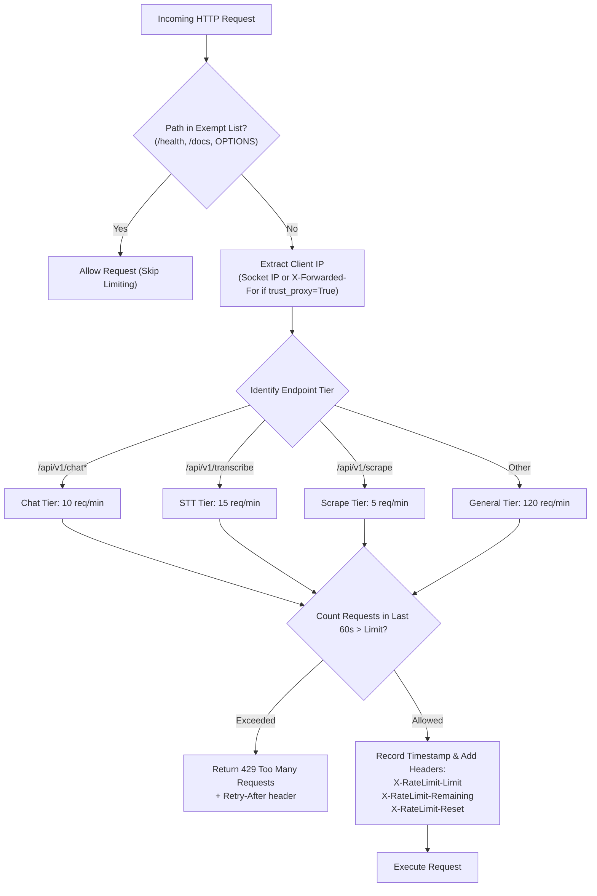

# 03 — Backend API & Core Services

## 1. FastAPI Application Architecture (`backend/main.py`)

`backend/main.py` provides the asynchronous HTTP and Server-Sent Events (SSE) application layer for Opportunities-Details. It cleanly separates routing from business logic by coordinating database access, hybrid RAG retrieval, agent dispatching, audio transcription, and background scraping.

### 1.1 Application Lifespan & Initialization
The backend uses FastAPI's `lifespan` context manager for structured startup and teardown:
1. **Database Bootstrap**: Calls `init_db()` to create SQLite tables (`opportunities`, `sessions`, `messages`, `opportunities_fts`) and configure WAL mode.
2. **Search Index Verification**: Validates that FAISS index files exist; initializes in-memory vector stores and BM25 representations.
3. **Optional Model Pre-warming**: Initializes the STT transcriber instance in the background to prevent first-request latency spikes.
4. **Graceful Shutdown**: Flushes open connections and releases thread pools cleanly.

### 1.2 Global Middleware Stack
- **CORS Middleware**: Permissive CORS for development with customizable allowed origins configured via `API__CORS_ORIGINS`.
- **Sliding-Window Rate Limiting Middleware**: Custom in-memory sliding-window limiter enforcing tiered request quotas per IP address.

---

## 2. API Endpoints Reference

### 2.1 Chat & Streaming

#### `POST /api/v1/chat/stream`
Streams token-by-token responses using Server-Sent Events (SSE).
- **Request Body**:
  ```json
  {
    "prompt": "Are there scholarships in the UK for Computer Science?",
    "session_id": "optional-uuid-string",
    "conversation_history": [
      {"role": "user", "content": "Hello"},
      {"role": "assistant", "content": "How can I help you today?"}
    ],
    "provider": "Ollama",
    "think": false,
    "rerank": false,
    "debug": false
  }
  ```
- **Stream Protocol**:
  - SSE frames formatted as `data: {"token": "..."}\n\n`.
  - Thinking reasoning is enclosed inside `<think>...</think>` tokens.
  - Final metadata sentinel line emitted at stream end:
    ```json
    [[METADATA]]{"is_opportunity": true, "retrieved_docs": [...], "used_tools": ["search_local_opportunities"]}
    ```

#### `POST /api/v1/chat`
Synchronous non-streaming chat endpoint returning a single `ChatResponse` JSON payload.

---

### 2.2 Sessions & History Management

| Method | Path | Description |
|---|---|---|
| `GET` | `/api/v1/sessions` | Lists all chat sessions sorted by `updated_at DESC`. |
| `POST` | `/api/v1/sessions` | Creates an explicit new chat session container. |
| `GET` | `/api/v1/sessions/{session_id}/messages` | Retrieves conversation history turns for a session. |
| `DELETE` | `/api/v1/sessions/{session_id}` | Deletes a session and cascades deletes all associated messages. |

---

### 2.3 Opportunities Exploration & Search

#### `GET /api/v1/opportunities`
Fetches paginated opportunity records with full-text search and source filtering.
- **Query Parameters**:
  - `limit` (int, default `20`, max `100`): Page size.
  - `offset` (int, default `0`): Pagination offset.
  - `search` (str, optional): Search query matched against title and content via SQLite FTS5 (BM25 ranking).
  - `source` (str, optional): Filters opportunities by portal identifier (e.g., `youthop`, `greatyop`).
- **Response**:
  ```json
  {
    "items": [
      {
        "id": 42,
        "title": "Chevening Scholarships 2026/2027",
        "source": "scholars4dev",
        "url": "https://www.scholars4dev.com/3299/chevening-scholarships-for-international-students/",
        "deadline": "2026-11-05",
        "organization": "UK Foreign, Commonwealth and Development Office",
        "location": "United Kingdom",
        "type": "Fully Funded",
        "created_at": "2026-09-15T12:00:00"
      }
    ],
    "total": 450,
    "limit": 20,
    "offset": 0
  }
  ```

#### `GET /api/v1/opportunities/{opp_id}`
Returns complete details for a single opportunity, including raw content and structured SLM `profile_json`.

---

### 2.4 Voice & Scraper Management

#### `POST /api/v1/transcribe`
Accepts an audio file upload (`multipart/form-data`) and returns transcribed text.
- **Payload**: `file: UploadFile` (WAV, MP3, WebM, OGG, or FLAC).
- **Response**: `{"text": "Find me masters scholarships in Canada"}`.

#### `POST /api/v1/scrape`
Triggers an asynchronous scraping run across portals as a FastAPI background task.

#### `GET /api/v1/scrape/status`
Returns real-time scraping progress, currently active portal, and total parsed items.

#### `GET /api/v1/health`
Returns system health, database connectivity, vector index document counts, and semantic cache hit/miss statistics.

---

## 3. Rate Limiting Middleware (`backend/rate_limit.py`)

`backend/rate_limit.py` provides an in-memory, zero-dependency sliding-window rate limiter protecting the API against overload and scraping abuse.



### 3.1 Security & Spoofing Defense
Client IP addresses are extracted directly from the ASGI socket by default (`request.client.host`). If running behind a trusted reverse proxy (e.g., NGINX, Cloudflare, Traefik), operators can enable `API__RATE_LIMIT_TRUST_PROXY=true` in `.env` to safely read `X-Forwarded-For`. When disabled, user-supplied `X-Forwarded-For` headers are strictly ignored, preventing quota spoofing.

---

## 4. Semantic & Hash Answer Cache (`backend/answer_cache.py`)

To deliver instantaneous responses and conserve LLM compute, `backend/answer_cache.py` implements a hybrid caching layer.

### 4.1 Tiered Cache Architecture
1. **Configuration Hash Guard**: Each cache entry is bound to a SHA-1 hash of the active LLM configuration (`provider`, `model`, `thinking_enabled`, `reranker_enabled`). If the user switches models, entries from other models are never returned.
2. **Exact Text Matching (O(1))**: A normalized hash of the prompt query instantly serves identical previous questions.
3. **Semantic Cosine Similarity**: Embeds incoming single-turn queries using `e5-small-v2` and searches previous queries. If cosine similarity meets or exceeds `0.93`, the cached response is served.
4. **Multi-Turn & Debug Bypass**: Queries with prior conversation history or active debug flags bypass the cache to guarantee contextual conversational integrity.
5. **Corpus Invalidation via Epochs**: When scrapers ingest new data or re-index the FAISS store, the cache epoch increments, instantly and safely invalidating outdated cached answers.

---

## 5. Moonshine Speech-to-Text (`backend/stt.py`)

Hands-free voice querying is powered by `MoonshineTranscriber`.

### 5.1 Technical Implementation
- **Underlying Model**: `UsefulSensors/moonshine-tiny` loaded via Hugging Face `transformers.pipeline("automatic-speech-recognition")`.
- **Resource Footprint**: Consumes only ~50MB of RAM and executes in ~120ms on modern CPUs, leaving 100% of GPU VRAM dedicated to LLM generation.
- **Audio Processing Pipeline**:
  1. Accepts arbitrary container formats (WebM from browsers, WAV, MP3, M4A, OGG).
  2. First attempts native decoding via `soundfile`.
  3. If format headers are non-standard, falls back transparently to `pydub`.
  4. Converts stereo audio to mono float32 and resamples to 16,000 Hz before passing into the ASR pipeline.

