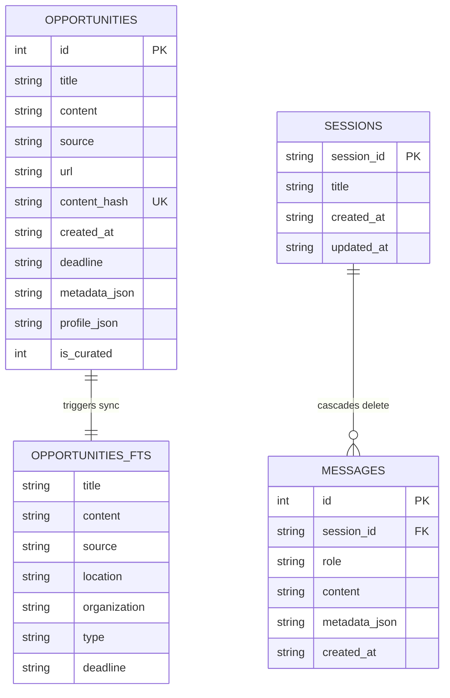

# 04 — Database & Search Layer

## 1. Persistence Layer Architecture (`backend/database.py`)

`backend/database.py` manages all relational storage, full-text indexing, session history, and deduplication for Opportunities-Details. It operates directly on standard Python `sqlite3`, deliberately avoiding heavyweight ORMs to ensure maximum performance, zero external service dependencies, and auditable queries.

### 1.1 Concurrency & WAL Mode
SQLite database connections are managed via a thread-safe context manager `get_db_connection()` that automatically configures:
- **Write-Ahead Logging (WAL)**: `PRAGMA journal_mode=WAL;` allows concurrent readers while a write transaction is in progress.
- **Busy Timeout**: `PRAGMA busy_timeout=5000;` prevents `database is locked` errors during background ingestion by waiting up to 5 seconds for write locks to clear.
- **Synchronous Mode**: `PRAGMA synchronous=NORMAL;` delivers high write throughput while maintaining ACID safety in WAL mode.
- **Foreign Keys**: `PRAGMA foreign_keys=ON;` enforces relational cascade deletes between sessions and messages.

---

## 2. Relational Schema Definitions



### 2.1 Table Schemas

#### `opportunities`
Stores scraped scholarship, fellowship, and internship listings.
- `id` (`INTEGER PRIMARY KEY AUTOINCREMENT`): Auto-incrementing identifier.
- `title` (`TEXT NOT NULL`): Cleaned and normalized title.
- `content` (`TEXT NOT NULL`): Extracted article body text.
- `source` (`TEXT NOT NULL`): Originating portal identifier (e.g., `youthop`, `greatyop`).
- `url` (`TEXT NOT NULL`): Canonical source URL.
- `content_hash` (`TEXT UNIQUE NOT NULL`): SHA-256 hash of `f"{title}:{content[:200]}"` preventing duplicate rows on re-scraping.
- `deadline` (`TEXT`): ISO-8601 date string (e.g., `2026-11-05`) for date-range filtering and sorting.
- `metadata_json` (`TEXT`): JSON representation of Stage 1 regex extraction (`deadline`, `organization`, `location`, `type`).
- `profile_json` (`TEXT`): JSON representation of Stage 2 SLM extraction conforming to `OpportunityProfile`.
- `is_curated` (`INTEGER DEFAULT 0`): Flag (`1` for curated roundups/directories like "Top 10 Fully Funded Scholarships", `0` for single opportunities). Indexed via `idx_opportunities_curated`.

#### `sessions` & `messages`
Maintains user conversation containers and multi-turn message history with foreign-key cascade deletion.

---

## 3. SQLite FTS5 Full-Text Search

To replace naive and unindexed `LIKE '%query%'` table scans, the database integrates SQLite's native **FTS5** (Full-Text Search) engine.

### 3.1 FTS5 Virtual Table & Tokenization
The `opportunities_fts` virtual table indexes searchable text fields:
```sql
CREATE VIRTUAL TABLE IF NOT EXISTS opportunities_fts USING fts5(
    title,
    content,
    source UNINDEXED,
    location,
    organization,
    type,
    deadline UNINDEXED,
    content='opportunities',
    content_rowid='id',
    tokenize='porter unicode61'
);
```
- **`tokenize='porter unicode61'`**: Combines Porter stemming (e.g., matching "scholarship" to "scholarships", "apply" to "application") with Unicode-aware case and accent normalization.
- **External Content Table**: Configured with `content='opportunities'` to avoid duplicating storage bytes between relational and search tables.

### 3.2 Automated Synchronization Triggers
Triggers ensure that insertions, updates, and deletions in `opportunities` instantly reflect in `opportunities_fts`:
- `opportunities_ai`: `AFTER INSERT ON opportunities`
- `opportunities_ad`: `AFTER DELETE ON opportunities`
- `opportunities_au`: `AFTER UPDATE ON opportunities`

### 3.3 Query Sanitization & BM25 Ranking
The search API uses `search_opportunities_fts(query, limit, offset, source_filter)`:
1. **Query Sanitization**: Strips special syntax characters (`"`, `*`, `(`, `)`, `:`, `NOT`, `OR`) that cause FTS parse errors, and formats remaining terms with wildcard prefix operators (e.g., `germany* masters*`).
2. **BM25 Relevance Ranking**: Results are ordered by SQLite's built-in BM25 algorithm via `ORDER BY rank`, ranking title matches higher than body occurrences.
3. **Resilient Token Fallback**: If an FTS syntax error occurs or zero results are returned, a fallback token matcher decomposes terms and searches with `LENGTH(title) ASC` preference.

---

## 4. Text Utilities & Normalization (`backend/text_utils.py`)

All scraped text passes through deterministic cleansing pipelines in `backend/text_utils.py`:

| Function | Purpose | Implementation Details |
|---|---|---|
| `clean_text(text)` | Cleans raw scraped HTML strings. | Applies Unicode NFKC normalization, removes replacement characters (`\ufffd`), unescapes HTML entities (`&amp;`), strips non-printable control chars, and collapses excessive whitespace. |
| `normalize_title(title)` | Produces human-readable, consistent opportunity titles. | Replaces naive `.title()` capitalization; preserves recognized academic and organizational acronyms (`USA`, `UK`, `DAAD`, `IELTS`, `GRE`, `PhD`, `STEM`, `LLM`, `MBA`), keeps small connector words lowercase (`in`, `of`, `for`, `and`), and strips portal branding suffixes. |
| `split_sentences(text)` | Splits bodies into grammatical sentences without fragmenting data. | Regular expression splitting that respects abbreviations (`Dr.`, `Prof.`, `e.g.`, `i.e.`, `vs.`, `Jan.`, `Nov.`). |
| `extract_title_from_content(text)` | Fallback title generation. | Extracts the first meaningful heading or line from content when portal metadata omits titles. |

---

## 5. Key Database Operations

- **`upsert_opportunities(items: List[Dict]) -> List[int]`**: Idempotent batch insertion based on SHA-256 content hashes. Uses `ON CONFLICT(content_hash) DO UPDATE` while preserving existing metadata on null values.
- **`update_opportunity_profile_and_metadata(opportunity_id, profile, metadata)`**: Single source of truth for enriching records with Stage 2 SLM profiles and updating FTS5 indexes.
- **`get_opportunity_by_title_or_query(name_or_query)`**: Pinpoints specific opportunity entities for direct deep-dive query resolution.
- **`get_opportunity_counts_by_source()`**: Returns portal distribution statistics used by the frontend dashboard.

