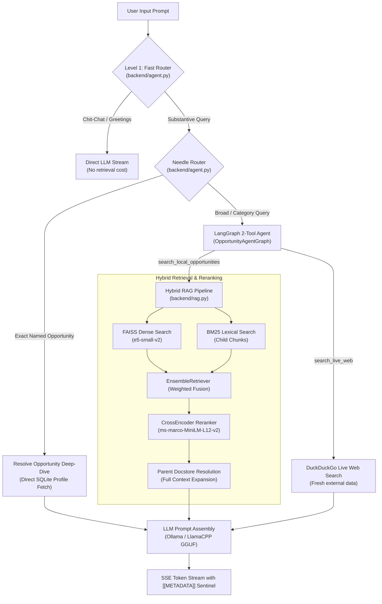
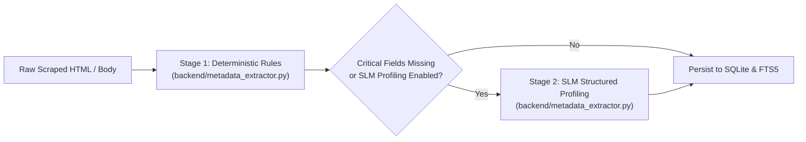

# 05 — RAG Engine & Agent Pipeline

## 1. Overview of Retrieval & Intelligence

The intelligence layer in Opportunities-Details delivers grounded, hallucination-free answers about global opportunities. It couples a multi-tier routing architecture with a hybrid retrieval pipeline and local Small Language Model (SLM) extraction.



---

## 2. Multi-Tier Query Routing

### 2.1 Level-1 Fast Regex Router (`backend/agent.py`)
Incoming prompts are evaluated in `<0.05ms` by `fast_router(prompt)` to avoid unnecessary database and vector queries for conversational inputs:
- **`DIRECT_CHAT`**: Triggers on greetings, conversational pleasantries, and meta-prompts (e.g., *"hello"*, *"who are you"*, *"thanks"*). Dispatches straight to the LLM without vector search.
- **`AGENT_TOOLS`**: Triggers on questions regarding scholarships, deadlines, criteria, universities, degrees, and funding.

### 2.2 Needle Router (`backend/agent.py`)
Standard chunk-based vector retrieval can fracture key requirements when a user asks about a specific, well-known opportunity. `NeedleRouter` intercepts targeted queries:
- **`resolve_opportunity_deep_dive(query, db)`**: Detects named scholarship entities (e.g., *"Chevening"*, *"DAAD EPOS"*, *"Fulbright"*, *"Turkiye Burslari"*), queries SQLite via `get_opportunity_by_title_or_query()`, and extracts the complete entity alongside its structured `profile_json`.
- **`format_curated_roundup(opportunities)`**: Generates authoritative, cleanly formatted bulleted overviews for comparison prompts without chunk fragmentation.

### 2.3 LangGraph 2-Tool Agent (`backend/agent.py`)
For open-ended inquiries, `OpportunityAgentGraph` deploys a native tool-calling agent equipped with two capabilities:
1. **`search_local_opportunities(query)`**: Executes hybrid FAISS + BM25 search over the local scraped opportunity database.
2. **`search_live_web(query)`**: Executes live web search via DuckDuckGo when queries involve breaking news, portal updates, or opportunities not yet indexed in the local repository.

---

## 3. Hybrid RAG Architecture (`backend/rag.py`)

### 3.1 Parent–Child Document Chunking
To prevent losing document context during vector search:
- **Parent Documents**: Full article text and source metadata stored in an in-memory parent docstore (`_build_parent_docstore`).
- **Child Chunks**: Content is split into 500-character child chunks with an 80-character overlap. Dense embeddings and BM25 indexes are constructed exclusively over child chunks.
- **Parent Resolution**: Once top child chunks are retrieved and reranked, `RAGPipeline` resolves them back to their parent documents, ensuring the LLM reads complete postings rather than truncated sentence fragments.

### 3.2 Dual Retrieval & Ensemble Fusion
- **Dense Vector Search**: Powered by `HuggingFaceEmbeddings("intfloat/e5-small-v2")` backed by a local `faiss_store/` index. Prefixes documents with `passage: ` and queries with `query: ` per model specifications.
- **Sparse Lexical Search**: `BM25Retriever` indexing word frequencies over child chunks for exact acronyms and proper nouns.
- **Ensemble Merge**: `EnsembleRetriever` merges both streams with balanced weighting, capturing both conceptual meaning and exact keyword hits.

### 3.3 Cross-Encoder Reranking
When `rerank=True` is requested (default is `False` / OFF to maximize streaming speed and reduce compute latency), the merged top candidates pass through `CrossEncoder("cross-encoder/ms-marco-MiniLM-L12-v2")`. The cross-attention model computes joint query-document relevance scores, distilling candidates down to the top-3 most pertinent context passages. When reranking is disabled, parent documents resolved from the top ensemble retrieval hits are used directly.

### 3.4 Response Streaming & Metadata Sentinel
`RAGPipeline.stream_answer()` yields tokens via SSE:
- Thought-chain reasoning inside `<think>...</think>` tags is segregated for frontend collapsible status display.
- Upon completion, the stream emits a trailing metadata sentinel line:
  ```
  [[METADATA]]{"is_opportunity": true, "retrieved_docs": [...], "used_tools": [...], "debug_info": {...}}
  ```

---

## 4. Metadata Extraction & SLM Profiling

The platform enriches unstructured opportunity postings using a two-stage approach:



### 4.1 Stage 1: Deterministic Heuristics (`backend/metadata_extractor.py`)
Executes synchronously in microseconds per item:
- **`_extract_deadline`**: Evaluates regex patterns against dates, normalizes multilingual month names (English, French, Spanish, German), and parses ISO dates using `dateparser`.
- **`_extract_organization`**: Identifies sponsoring bodies, universities, and governments from headers and signature blocks.
- **`_extract_location`**: Scans text against a 200+ country name and alias dictionary.
- **`_extract_type`**: Classifies opportunities into categories (*Scholarship*, *Fellowship*, *Internship*, *Grant*) and funding models (*Fully Funded*, *Partially Funded*, *Tuition Waiver*).

### 4.2 Stage 2: SLM Structured Profiling (`backend/metadata_extractor.py`)
Enriches opportunities into a strongly typed `OpportunityProfile` Pydantic model:
```python
class OpportunityProfile(BaseModel):
    program_name: Optional[str]
    provider_organization: Optional[str]
    host_country: Optional[str]
    degree_level: Optional[str]
    funding_type: Optional[str]
    application_deadline: Optional[str]
    eligible_nationalities: Optional[str]
    stipend_amount: Optional[str]
    key_benefits: Optional[str]
    summary: Optional[str]
```

#### Dual-Engine SLM Support:
- **`extract_profile_with_llamacpp`**: Invokes local GGUF models (e.g., `qwen2.5-0.5b-instruct-q4_k_m.gguf`) using JSON schema grammar enforcement.
- **`extract_profile_with_ollama`**: Invokes Ollama instances using native JSON output formatting.
- **Deduplication**: Both engines route output through `_coerce_profile_dict()` to guarantee consistent field fallback and clean defaults before writing to SQLite via `update_opportunity_profile_and_metadata()`.

