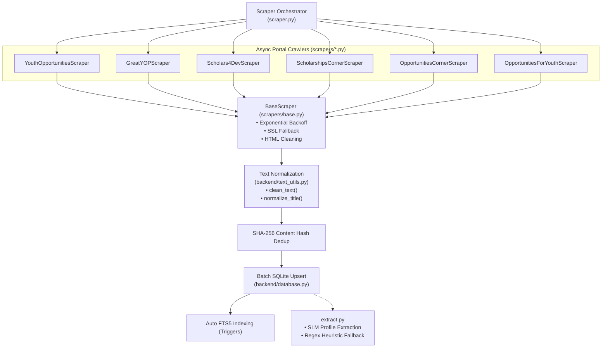
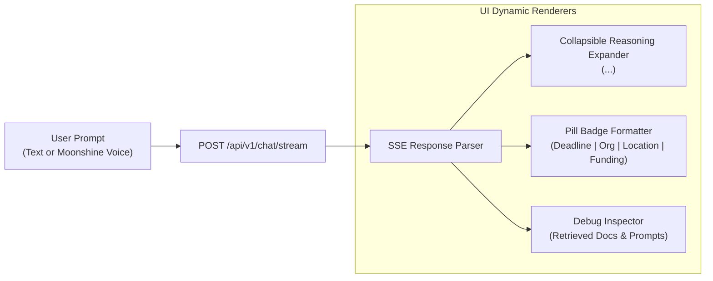

# 06 — Scrapers & Frontend Interface

## 1. Web Scraping Framework

Opportunities-Details continuously harvests scholarship and opportunity listings from 6 premier global platforms. The scraper subsystem is built on asynchronous Python (`asyncio`, `aiohttp`, `BeautifulSoup4`) with robust error handling, SSL fallback, and content deduplication.

### 1.1 Architecture & Crawling Flow



---

## 2. Base Scraper & Portal Implementations

### 2.1 Resilient Networking (`scrapers/base.py`)
The abstract `BaseScraper` encapsulates essential scraping utilities:
- **Exponential Backoff**: Automatically catches HTTP 429 (Too Many Requests) and 5xx errors, retrying with jittered delays.
- **SSL Fallback**: If a portal has expired or misconfigured SSL certificates, requests fall back safely using an unverified context without crashing the crawler run.
- **User-Agent Rotation**: Dispatches modern desktop browser headers to prevent basic anti-bot blocking.
- **Text Cleansing**: Integrates `clean_text()` and `normalize_title()` from `backend/text_utils.py` to strip replacement characters (`\ufffd`), decode HTML entities, and remove site branding suffixes.

### 2.2 Portal Coverage Matrix

| Scraper Module | Portal Name | Primary Focus | Crawling Technique |
|---|---|---|---|
| `scrapers/youthop.py` | Youth Opportunities | Global youth contests, fellowships, scholarships | Category feed & sitemap traversal |
| `scrapers/greatyop.py` | Greatyop | Fully funded masters & PhD programs | Article listing pagination |
| `scrapers/scholars4dev.py` | Scholars4Dev | International university development scholarships | Category archives & sitemaps |
| `scrapers/scholarshipscorner.py` | Scholarships Corner | Global degree programs & exchange programs | Category archives |
| `scrapers/opportunitiescorner.py`| Opportunities Corner | International internships & conferences | Listing feeds |
| `scrapers/opportunitiesforyouth.py`| Opportunities For Youth | Youth leadership & social impact fellowships | Tag-based listing crawls |

---

## 3. Dedicated Extraction & Application Launchers

Ingestion is cleanly decoupled into focused CLI stages: crawling, profile extraction, and application serving.

### 3.1 Scraping Execution (`scraper.py`)
```bash
# Harvest raw opportunities from all 6 portals and persist to SQLite
python scraper.py
```

### 3.2 Structured Extraction Pipeline (`extract.py`)
Extracts structured attributes (`deadline`, `organization`, `location`, `type`, `eligibility`, `benefits`, `summary`) using local SLMs with automatic regex fallback and automatic `llama-server` process management:

```bash
# Extract pending opportunities missing profiles (auto-boots SLM if offline)
python extract.py

# Force re-extraction across all opportunities
python extract.py --all

# Fast deterministic extraction using regex/heuristics only (no GPU / no model)
python extract.py --regex-only

# Process a custom subset with concurrency limits
python extract.py --limit 50 --concurrency 2
```

### 3.3 Application Launcher (`pipeline.py`)
Directly launches the local chat LLM (`llama-server`), FastAPI backend, and Streamlit frontend together:

```bash
# Launch full stack directly (zero port conflicts)
python pipeline.py

# Run extraction phase via pipeline
python pipeline.py --extract

# Interactive menu
python pipeline.py -i
```

---

## 4. Streamlit Frontend Interface (`streamlit_app.py`)

The user interface is an interactive, two-tab Streamlit application providing real-time AI assistance, hands-free voice transcription, and opportunity discovery.

### 4.1 Tab 1: Chat Assistant



- **SSE Streaming**: Consumes tokens as they arrive over HTTP SSE, providing instantaneous feedback.
- **Invoked Agent Tool Badges**: Displays non-expandable native `st.status` indicators (e.g., `🌐 Searched the web`, `🔍 Deep Dived into Opportunity`, `📚 Searched Knowledge Base`) directly above assistant responses, informing the user of the retrieval mechanism used without exposing raw internals.
- **Thought Reasoning Visualization**: Separates `<think>...</think>` tokens generated by reasoning models (such as Qwen 2.5 / DeepSeek R1) into a collapsible, styled status container.
- **Opportunity Pill Badges**: Automatically detects `Deadline: | Organization: | Location: | Type:` lines in assistant answers and renders them as colored HTML badge components.
- **Curated Opportunity Chips**: Dynamic quick-action buttons loaded from `/api/v1/opportunities/curated` (or static fallbacks) providing 0ms one-click access to curated roundups (e.g., "Top 10 Fully Funded Scholarships").
- **Hands-Free Moonshine STT**: Audio recorded from the client microphone is sent directly to `/api/v1/transcribe` and transcribed in ~120ms on CPU, automatically placing the prompt into the chat input.
- **Debug & Context Inspector**: Expandable drawer revealing the system prompt template, exact retrieved chunks, similarity scores, and tool invocations.

### 4.2 Tab 2: Explore Opportunities

- **FTS5 BM25 Search**: Users can search titles, bodies, and metadata with sub-millisecond full-text queries.
- **Source Filter**: Dropdown allowing users to isolate listings by specific portal origin.
- **Lightweight Card Virtualization ("Load More")**:
  - Transmits lightweight summaries (titles, URLs, deadlines, locations, badges) rather than sending 5,000+ character raw HTML bodies over the wire.
  - Features an intuitive **"Load More"** pagination button that appends 20 items per click, preventing browser DOM degradation and UI lag.
  - Expandable modal view provides full post content on demand.

### 4.3 Sidebar & Session Controls
- **Chat Session Manager**: Enables users to switch between conversation histories, create new sessions, or delete sessions.
- **Inference Configuration**: Provides runtime selection between Ollama and local GGUF models (`LLamaCPP`), and thinking mode toggles.
- **Debug Mode & Scraper Controls**: The Run Scraper trigger, Status check, and Reranking toggles are moved to Debug Mode (activated via CLI `--debug` flag or `DEBUG=true` in `.env`), keeping the standard user interface clean and distraction-free.

